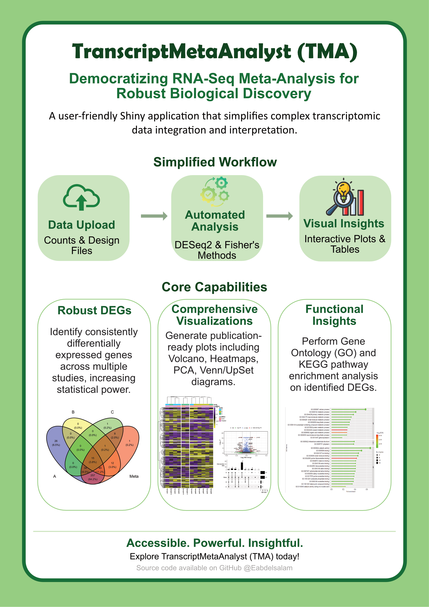

# TranscriptMetaAnalyst

### A graphical user interface to meta-analyze RNA-Seq and microarray transcriptomics data



This app is designed to help biologists with less programming skills to perform meta-analysis of several transcriptomic data sets (RNA-Seq or microarray) in order to get robust results and new insights into the data that was generated by their own studies or the data available online.

## Installation

The app could be installed locally via [GitHub](https://github.com/Eabdelsalam/TransciptMetaAnalyst) using the following commands (please note that `BiocManager` and `devtools` packages should be installed before installing the app):

1.  Check if devtools and BiocManager are installed, and install them if not

`if (!requireNamespace("devtools", quietly = TRUE)) {   install.packages("devtools") }`

`if (!requireNamespace("BiocManager", quietly = TRUE)) {   install.packages("BiocManager") }`

2.  Use `devtools` to install the ShinyApp

`devtools::install_github("Eabdelsalam/TranscriptMetaAnalyst")`

3.  Finally, run the app

`library(TranscriptMetaAnalyst)`

`runTMA()`

## Study requirements

- **Input files**: a tab-delimited raw counts file with a `Geneid` column and one column per sample, and an experimental design file with the columns `sample`, `study` and `condition` (and optionally `batch`).
- **Conditions**: at least two. With more than two, every condition is compared with a reference condition chosen in the app (all vs. reference), and each comparison gets its own results tab.
- **Replicates**: at least 2 samples per condition in a study. A condition with fewer samples is left out of that study, and the study is not used for the comparisons that involve that condition.
- **Studies**: at least 2 studies per comparison. A comparison with fewer studies is not meta-analysed; if no comparison can be meta-analysed, the analysis stops with an explanation.
- **Microarrays**: the *Microarray Meta-Analysis* tab takes normalised single-colour microarray data, either one tab-delimited expression file per study (first column: probe IDs; optional `Symbol` column: the gene of each probe; other columns: samples) with the same design file, or GEO series imported by accession. Values are log2-transformed when needed, probes are collapsed to genes (highest mean expression), only genes measured in every study are kept, and each study is analysed with limma. Two-colour arrays are not supported.

The app tells you which studies and comparisons it left out and why. See the [user manual](manual/TMA_Manual.md) for details.

## Reproducibility

After an analysis, the app can write an R script that repeats it with the same settings (**Download R script**). For your own data, the input file paths in the script are placeholders that you replace with the paths of your files. The analysis can also be run directly from R:

```r
library(TranscriptMetaAnalyst)
counts <- read_tma_table("counts.txt")
design <- read_tma_table("design.txt")
analysis <- run_tma_analysis(counts, design, de_method = "DESeq2", meta_method = "fisher")
analysis

# microarrays: one expression file per study
matrices <- list(read_array_matrix("study1.txt"), read_array_matrix("study2.txt"))
array_analysis <- run_array_analysis(matrices, design, meta_method = "fisher")
```
