# TranscriptMetaAnalyst (TMA) User Manual

**Eslam M. Abdel-Salam**¹

¹ Plant Molecular Biology, Faculty of Biology, Ludwig-Maximilians-Universität München, Munich, Germany

> TranscriptMetaAnalyst (TMA) is a graphical user interface to meta-analyze RNA-Seq transcriptomics data. It is designed to help biologists with less programming skills to perform meta-analysis of several transcriptomic RNA-Seq-generated data sets in order to get robust results and new insights into the data that was generated by their own studies or the data available online.

*This Markdown manual is based on `TMA_Manual.pdf` and is updated for the current development version. The changes are listed in [What is new in this version](#what-is-new-in-this-version).*

## Table of contents

- [What is new in this version](#what-is-new-in-this-version)
- [1 Introduction](#1-introduction)
- [2 Installation](#2-installation)
- [3 Quick Start](#3-quick-start)
- [4 App Layout](#4-app-layout)
  - [4.1 Home Tab](#41-home-tab)
  - [4.2 RNA-Seq Meta Analysis](#42-rna-seq-meta-analysis)
  - [4.3 Run Demo Analysis](#43-run-demo-analysis)
  - [4.4 User Manual](#44-user-manual)
- [5 Analysis Pipeline](#5-analysis-pipeline)
- [6 Outputs](#6-outputs)
  - [6.1 Overview & Information Boxes](#61-overview--information-boxes)
  - [6.2 Main Plots](#62-main-plots)
  - [6.3 DEGs Table & Count Plots](#63-degs-table--count-plots)
  - [6.4 Functional Annotation](#64-functional-annotation)
- [References](#references)

## What is new in this version

Several of these changes fix errors in the results of earlier versions, so results produced with an earlier version (PCA, heatmap, volcano plot and GO/KEGG enrichment) should be regenerated. The others make the app faster and easier to use.

| Area | Change |
|------|--------|
| Heatmap | The heatmap values are now attached to the correct gene and sample. Earlier versions could place values in the wrong cells. The heatmap no longer fails when the meta-analysis finds fewer DEGs than there are samples. |
| Heatmap clusters | A new **Number of gene clusters** input (default 2) sets how many clusters the genes are split into, both in the interactive heatmap and in the downloaded PDF. |
| PCA | The PCA now uses the correct normalized counts for every sample. Earlier versions mixed values between genes and samples. |
| Volcano plot | The x-axis now shows the correct mean log2 fold change of each gene across studies. Very small *p*-values are now kept exact, so the most significant genes are drawn at their real height instead of on a flat line at the top of the plot. |
| GO / KEGG enrichment | Enrichment is now run on the meta-analysis DEGs only (significant in the meta-analysis *and* changed in the same direction in every study). Earlier versions used every gene with a consistent direction, whether significant or not. |
| Closing the app | When the app is started with `runTMA()`, it stops when its browser window is closed, as before. When it is deployed on a Shiny Server, closing one browser window no longer shuts the app down for all other users. |
| Methods | Besides DESeq2, the differential expression can now be run with edgeR or limma-voom, for all studies or chosen per study. Besides Fisher's method, the *p*-values can be combined with the inverse-normal method. See [Analysis settings](#422-analysis-settings). |
| Batch effects | The experimental design file can have an optional `batch` column. Batch can be added to the DE model (`~ batch + condition`) or removed from the raw counts with ComBat-seq, and the PCA and heatmap can use batch-corrected values. A new **Batch effects** tab shows PCA and RLE plots before and after the correction. See [Batch effects](#423-batch-effects). |
| Speed | The studies are analysed in parallel, and an uploaded analysis runs in the background, so the app stays responsive while it runs. The **Start Analysis!** button is disabled until the running analysis has finished. |
| Demo | The demo analysis is computed the first time the **Run Demo Analysis** tab is opened and then reused, so opening the tab again shows the results immediately. |
| Low-count genes | Genes with too few reads in every study are removed before the analysis (see [Analysis Pipeline](#5-analysis-pipeline)). They no longer appear in the results table. |
| Downloads | The downloaded DEG list of each study now has the columns `gene`, `base_mean`, `log2_fc`, `lfc_se`, `stat`, `pvalue` and `padj`. The GO results table can be downloaded again (this download failed in earlier versions). |

## 1 Introduction

Meta-analysis of RNA-Seq transcriptomics data has become an essential tool in modern biology to identify differentially expressed genes (DEGs) and pathways across multiple studies [1, 2]. However, performing meta-analysis can be a challenging task, especially for biologists with limited programming skills. To address this issue, we have developed the TranscriptMetaAnalyst (TMA) app, a graphical user interface (GUI) designed to facilitate the meta-analysis of RNA-Seq transcriptomics data.

TMA allows users to easily combine and analyze multiple RNA-Seq datasets, providing a robust and reliable way to identify differentially expressed genes and pathways. The app is built on top of the popular R programming language and uses the metaRNASeq package [3] to perform the meta-analysis. With TMA, users can upload their own RNA-Seq data or use publicly available datasets along with a simple experimental design file, and run the whole analysis with a single click to get publication-ready figures and tables.

TMA is particularly useful for researchers who want to:

- Identify differentially expressed genes and pathways across multiple studies
- Combine data from different studies to increase statistical power
- Visualize the results of the meta-analysis using different methods, e.g., heatmaps and volcano plots

By providing a user-friendly interface to perform meta-analysis, TMA aims to facilitate the discovery of new insights and robust results in transcriptomics research.

## 2 Installation

The app can be installed locally from [GitHub](https://github.com/Eabdelsalam/TranscriptMetaAnalyst) with the following commands (the `BiocManager` and `devtools` packages should be installed before installing the app):

```r
# Check if devtools and BiocManager are installed, and install them if not
if (!requireNamespace("devtools", quietly = TRUE))
  { install.packages("devtools") }
if (!requireNamespace("BiocManager", quietly = TRUE))
  { install.packages("BiocManager") }
# Now you can use devtools to install the ShinyApp
devtools::install_github("Eabdelsalam/TranscriptMetaAnalyst")
# Finally, run the app
library(TranscriptMetaAnalyst)
runTMA()
```

When started with `runTMA()`, the app stops automatically when its browser window is closed. When the app is deployed on a Shiny Server, it keeps running for other users when one user closes their window.

## 3 Quick Start

To start the RNA-Seq meta-analysis, click on the **RNA-Seq Meta Analysis** tab and perform the following steps:

- After cleaning the raw RNA-Seq read files (either downloaded from public databases or generated in your own experiments) of each sample, align them individually to the studied organism's reference genome.
- Count the mapped reads for the genomic features of interest and combine all the counts in one file, keeping genomic features as rows and the samples that will be included in the analysis as columns. This produces the final raw (unnormalized) counts file. ***Note that the counts file should have a 'Geneid' column.***
- Upload the counts file produced by any feature counting tool, e.g., featureCounts or htseq-count, to the raw counts placeholder. ***Please refer to the example counts file via the provided download link.***
- Upload the experimental design file. ***Please refer to the example file via the provided download link.*** This file should contain at least 3 columns: 'sample' refers to the sample names used as columns in the counts file, 'study' refers to the study to which the sample belongs, and 'condition' refers to the treatment or control conditions (only two conditions are allowed for comparison).
- Optionally, choose the differential expression and meta-analysis methods in the **Analysis settings** box (the defaults are DESeq2 and Fisher's method).
- Hit the ***Start Analysis!*** button and wait for the results to appear.
- To perform further **Functional Annotation** of the DEGs identified via the meta-analysis, use the functional annotation box in the bottom-left corner of the page. The user needs to choose the organism before performing this analysis. This analysis needs an active internet connection and might take a while.

## 4 App Layout

### 4.1 Home Tab

After running TMA, the layout shown in Figure 1 opens in a separate window. The top left corner holds the app name. The left panel holds the different tabs that form the core of the app and its functionality. The three-bar symbol beside the app name toggles the side panel on and off. The **Home** tab opens by default when the app starts and contains brief information about the app and its components.

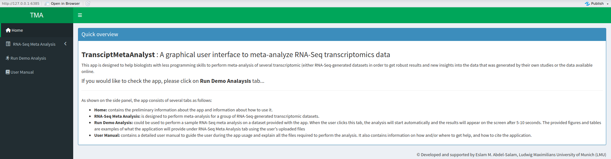

*Figure 1: Layout of the TranscriptMetaAnalyst app. The app opens the home tab by default, showing brief information about the app and how to use it.*

### 4.2 RNA-Seq Meta Analysis

This tab contains all the information needed to perform a meta-analysis of RNA-Seq data using TMA. As shown in Figure 2, the tab shows the *Quick Start* steps to run the analysis. On the left panel, there are two placeholders for the required input files (discussed below). There are also two links to download example (template) files that guide the user in preparing the raw counts and the experimental design files, or that can be used as templates to paste their own counts into.

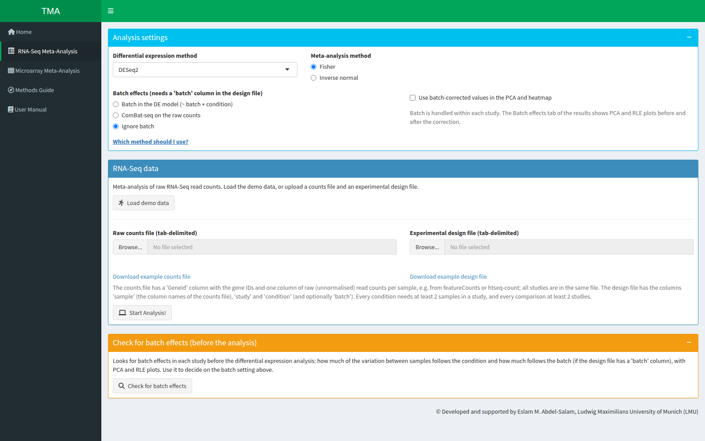

*Figure 2: RNA-Seq Meta Analysis tab. This is the main tab of TMA, where users analyze their own data.*

#### 4.2.1 Input Files

To perform a meta-analysis of RNA-Seq data using TMA, the user needs two input files:

1. The ***raw counts file***: a tab-delimited file that contains the raw counts of all the experiments to be analyzed, where each row represents a single gene and each column represents all counts from a single sample. Figure 3 shows an example of the raw counts file.

2. The ***experimental design file***, which should contain at least 3 columns: sample, study, and condition. An example of this file is shown in Figure 4. The study column should contain records for all the count columns in the raw counts file. The condition column should contain only two unique conditions to be compared via the meta-analysis. An optional fourth column, `batch`, gives the batch of each sample within its study (for example the sequencing run or library preparation date); see [Batch effects](#423-batch-effects).

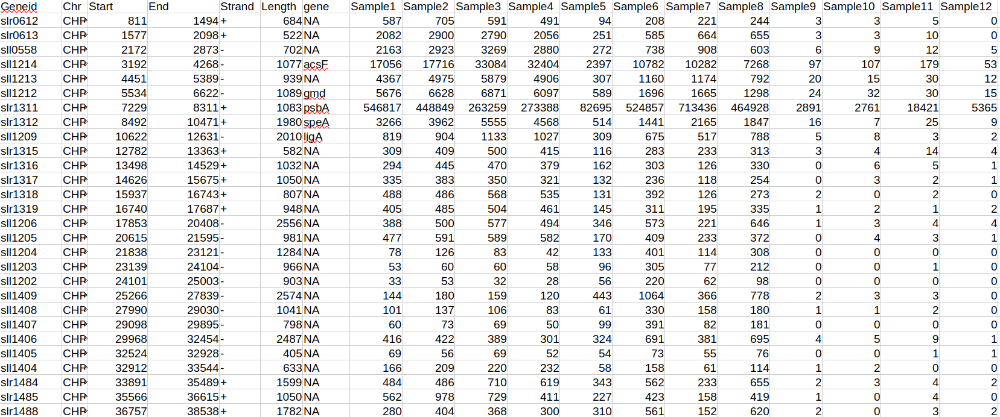

*Figure 3: An example of the raw counts file needed for the analysis. Note that the file contains a 'Geneid' column.*

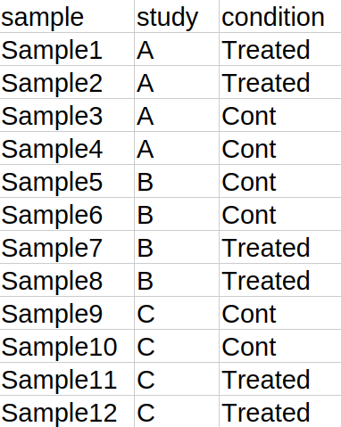

*Figure 4: An example of the experimental design file. This example file contains the three required columns only.*

#### 4.2.2 Analysis settings

The **Analysis settings** box at the top of the tab sets how the data are analysed:

- **Differential expression method**, used in each study: DESeq2 (default) [4], edgeR (quasi-likelihood F-test) [9] or limma-voom [10, 11].
- **DE method per study (optional)**: once the experimental design file is uploaded, one drop-down per study lets you use a different method for that study. "Same as above" uses the method chosen for all studies.
- **Meta-analysis method**: Fisher's method [5] (default) or the inverse-normal method [3], which weights each study by the square root of its number of samples.

The **Which method should I use?** link in the box gives a short guide:

- DESeq2 and edgeR both model counts with a negative-binomial distribution and work well with few replicates per group; in a benchmark with few replicates they were among the best-performing tools [12].
- limma-voom fits linear models on log-counts with precision weights. It is fast and a good choice for larger studies or when library sizes differ a lot.
- Fisher's method can make a gene significant on the strength of a single study.
- The inverse-normal method favours genes with consistent evidence across studies and gives larger studies more weight.

Changes take effect the next time **Start Analysis!** is clicked. The methods used are shown in the *Number of studies* box of the results.

#### 4.2.3 Batch effects

If the experimental design file has a `batch` column, the **Analysis settings** box also shows the batch options. Batch is handled within each study:

- **Batch in the DE model (~ batch + condition)** (default): the batch effect is estimated together with the condition effect. The counts are not changed.
- **ComBat-seq on the raw counts**: the raw counts of each study are corrected for batch with ComBat-seq [13], keeping the condition effect, and then analysed with `~ condition`. This needs at least two samples in every batch.
- **Ignore batch**: the `batch` column is not used.
- **Use batch-corrected values in the PCA and heatmap**: draws these two plots from batch-corrected values (the ComBat-seq counts if ComBat-seq was used, otherwise values from `limma::removeBatchEffect()` [11]). This option only changes the plots, not the DE analysis.

Batch can only be used in a study that has at least two batches, whose batches are not confounded with the condition, and that keeps enough samples to estimate the model. A study that does not meet these conditions is analysed with `~ condition`, and the **Batch effects** tab of the results names the study and the reason.

### 4.3 Run Demo Analysis

The Demo Analysis tab (Figure 5) gives users hands-on experience of how TMA works. By clicking the ***"Run Demo Analysis"*** tab, users run a demo analysis using simulated data of *Synechocystis* sp. based on our previously published meta-analysis [1]. After clicking, a message shows that the demo analysis is running. After a while, the message disappears and the results become visible. The demo analysis generates the entire set of results, including all the meta-analysis outputs and figures discussed in the [Outputs](#6-outputs) section. This lets users test the app's functionality, understand the analysis workflow, and learn how to navigate the app's tabs and sections before working with their own data.

The Demo tab has its own **Analysis settings** box with the differential expression and meta-analysis methods (without the per-study option), so all method combinations can be tried on the demo data. The results update when a setting is changed; each combination is computed once and then reused.

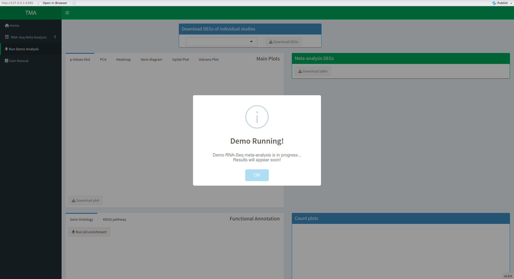

*Figure 5: The Run Demo Analysis tab lets users test the app. Clicking on this tab triggers the analysis, and the results appear shortly.*

### 4.4 User Manual

The last tab on the left panel is the *User Manual* tab. It provides a link to the current detailed guide of TMA, information on contacting the creators of the app, and how to cite the app in scientific publications (Figure 6).

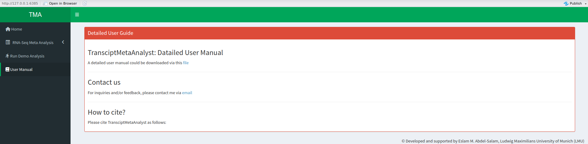

*Figure 6: The User Manual tab of TMA, with links to download the detailed guide and to contact the app's creators, along with citation information.*

## 5 Analysis Pipeline

After uploading the required files, several checks are performed to make sure that the files meet the analysis requirements. The user is notified about any problems in the files and asked to fix them before re-running the analysis.

If the files pass the checks, the analysis starts automatically and a loading screen appears until the results are ready. Behind the scenes:

1. Genes with too few reads are removed with the `filterByExpr` function of the edgeR package [9]. A gene is kept for all studies if it has enough reads in at least one study; genes that are low in every study are removed. Within each study, DESeq2's own filtering still handles genes that are low there.
2. DEGs are identified in each study separately with the chosen method: DESeq2 [4], edgeR [9] or limma-voom [10, 11]. The studies are analysed in parallel. Whatever the method, the plots (PCA, heatmap, count plots) use DESeq2-normalised counts, so they look the same for every method.
3. The raw *p*-values of the studies are combined with Fisher's method [5] or the inverse-normal method via the metaRNASeq package [3], and the combined *p*-values are adjusted with the Benjamini–Hochberg method. Genes with an adjusted meta-analysis *p*-value ≤ 0.05 are significant.
4. As a validation step, genes with conflicting directions (up-regulated in one study and down-regulated in another) are removed. The remaining significant genes are the **meta-analysis DEGs**. They are used for the heatmap, the Venn/UpSet plots and the functional annotation.

If the user would like to perform further functional annotation of the identified DEGs, Gene Ontology (GO) and KEGG pathway enrichment analyses can be run on the **meta-analysis DEGs**. For GO, the user selects the studied organism from the drop-down menu (Figure 7a) and runs the analysis. This analysis is based on the PANTHER Classification System v17.0 [6] and is performed with the `rbioapi` package. The KEGG pathway enrichment analysis is performed with the clusterProfiler package [7]. For KEGG, the user types the 3-letter code of the studied organism, which can be found in the [KEGG Organisms Database](https://www.genome.jp/kegg-bin/get_htext?br08601), before running the analysis (Figure 7b). If the meta-analysis found no DEGs, the app shows a message instead of running the enrichment.

| (a) GO Enrichment | (b) KEGG Pathway Enrichment |
|---|---|
| 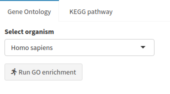 | 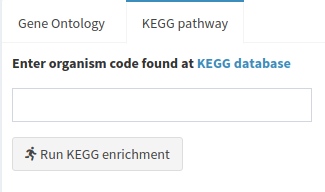 |

*Figure 7: Gene Ontology (GO) and KEGG pathway enrichment analysis in TMA. The user should (a) select the organism from the drop-down menu before running the GO analysis or (b) type the 3-letter code of the studied organism before running the KEGG pathway analysis.*

The same analysis can also be run from R without the app, for example to reproduce or extend the results:

```r
library(TranscriptMetaAnalyst)
counts <- read_tma_table("counts.txt")
design <- read_tma_table("design.txt")
res <- run_tma_pipeline(counts, design, de_method = "edgeR", meta_method = "invnorm")
res$meta_degs              # meta-analysis DEGs
plot_volcano(volcano_data(res))
```

Finally, the different outputs (discussed in the next section) are produced with in-house scripts along with built-in functions and other R packages. The outputs are grouped and shown in different boxes. All the outputs can be downloaded as PDF files for the figures or CSV files for the tables.

## 6 Outputs

### 6.1 Overview & Information Boxes

TMA provides the user with 7 main output boxes (Figure 8). At the top of the results screen, two information boxes on the left and right show the number of studies included in the analysis and the number of DEGs identified via the meta-analysis, respectively. In the middle, a box lets the user download the list of DEGs identified in each individual study.

Below the information boxes, the results screen is divided into 4 main sections. The top left box contains the main plots (discussed below). The top right box contains a table of all genes in the meta-analysis with their statistical parameters. This table can be searched and sorted, and downloaded as a CSV file for further analysis. Clicking on any row of the table updates the Count plots box (bottom right) with plots of the normalized counts of the selected gene across all the studies included in the meta-analysis. These plots can also be downloaded as a PDF file. The bottom left box contains the GO and KEGG pathway enrichment analysis and results (discussed below).

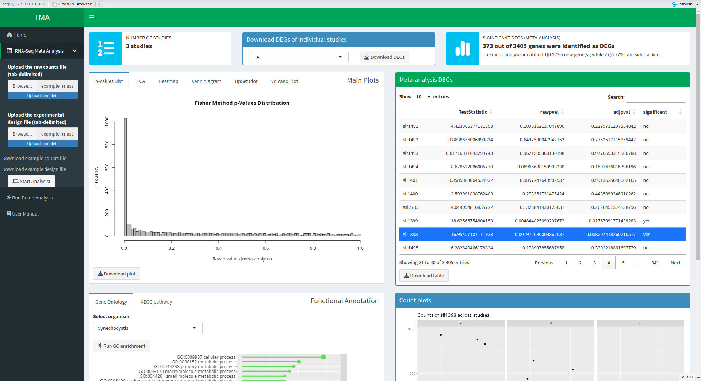

*Figure 8: An overview of the outputs generated by TMA.*

### 6.2 Main Plots

TMA generates several main plots to give the user an overview of the analyzed dataset and the identified DEGs. The figures below were produced from the demo data.

1. The ***p*-values distribution** plot (Figure 9) shows the distribution of all raw meta-analysis *p*-values (its title names the meta-analysis method), so the user can check their distribution. The *p*-value combination method assumes a uniform distribution under the null hypothesis, so no peak other than the one near zero should appear in the distribution.

   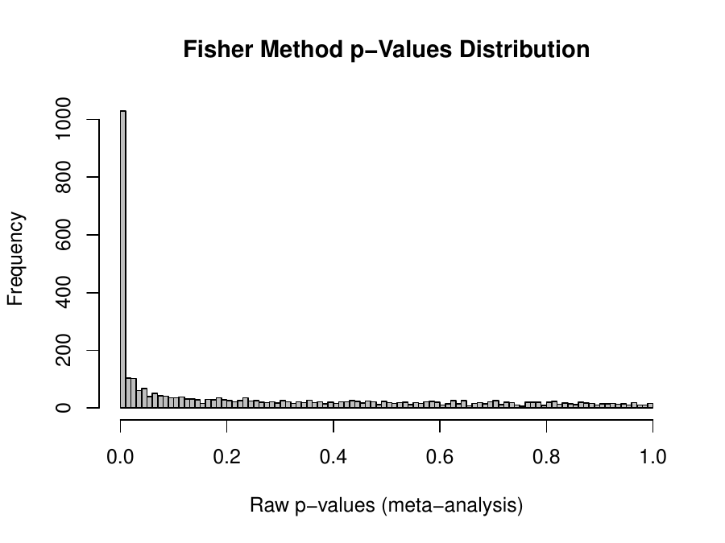

   *Figure 9: The p-values distribution histogram generated by TMA.*

2. The **Principal Component Analysis (PCA)** is performed with the DESeq2 package [4] on the log2-transformed normalized counts of all samples. The figure (Figure 10) can be used to identify the relationship between samples and/or biological replicates, and to identify potential outliers to exclude from the analysis. In the demo data, the first principal component separates the studies, which is expected when studies come from different experiments.

   

   *Figure 10: An example of the PCA plot generated by TMA.*

3. A **heatmap** (Figure 11) of the normalized counts of the meta-analysis DEGs is generated. The counts of each gene are scaled (z-scores) within each study, so the colours show how a gene changes between the samples of one study. In the TMA GUI, the heatmap is interactive and built with the `heatmaply` package [8]. The genes are grouped by hierarchical clustering. The **Number of gene clusters** box above the heatmap sets how many clusters the genes are split into (default 2, e.g., up- and down-regulated genes). It cannot be larger than the number of DEGs, and an empty or invalid value falls back to 2. The user can download the figure (not interactive), cut into the chosen number of clusters, or the data used to draw the heatmap for further analysis. A heatmap needs at least two meta-analysis DEGs; otherwise, a message is shown instead.

   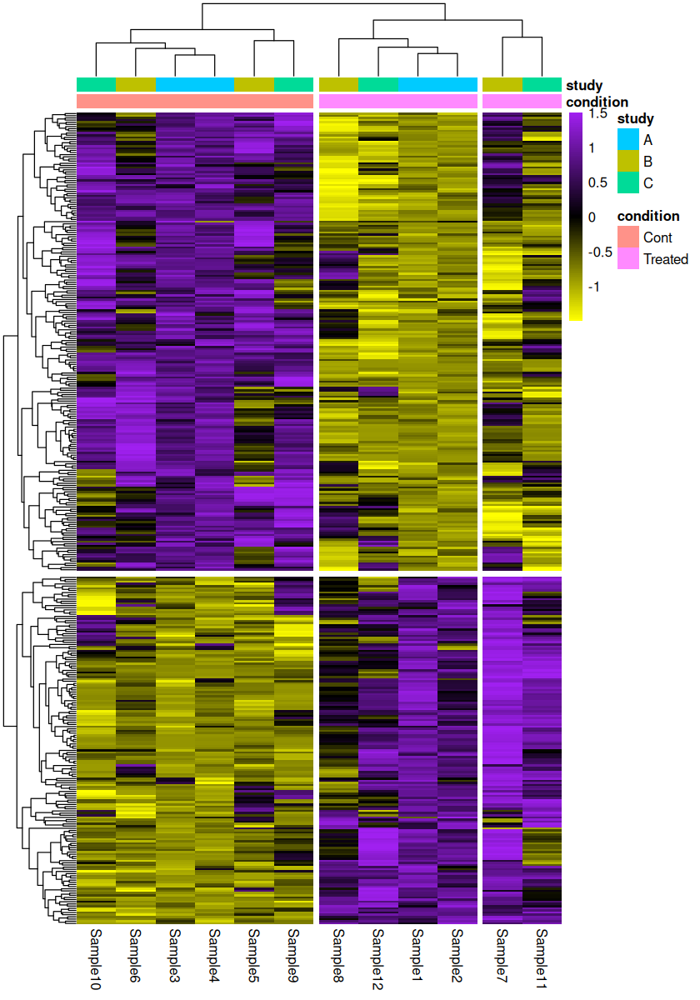

   *Figure 11: The downloadable (non-interactive) heatmap of the meta-analysis DEGs, split into the default 2 gene clusters.*

4. A **Venn diagram** (Figure 12a) and an **UpSet plot** (Figure 12b) show the intersection of identified DEGs across the analyzed studies and the meta-analysis. If more than 3 studies are included in the meta-analysis, the Venn diagram is disabled and only the UpSet plot is generated.

   | (a) Venn Diagram | (b) UpSet Plot |
   |---|---|
   | 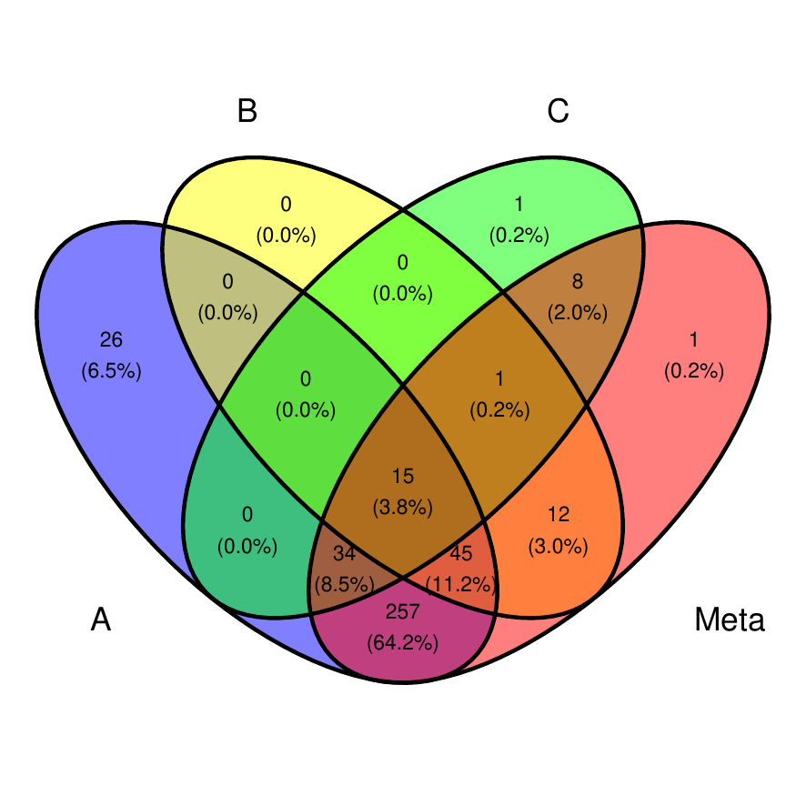 | 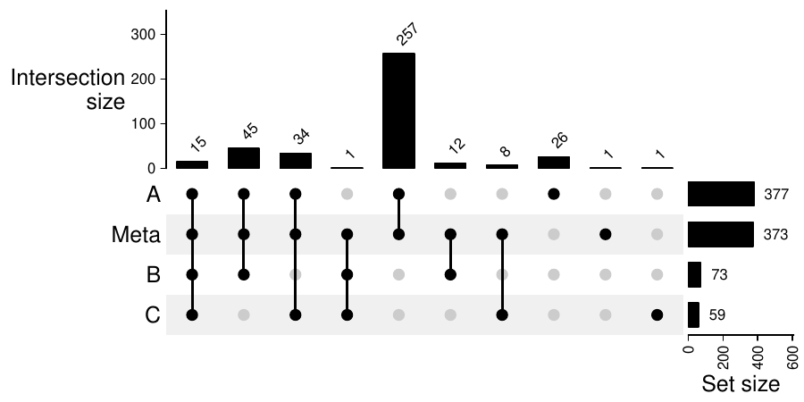 |

   *Figure 12: The intersection of identified DEGs is shown via (a) a Venn diagram, if the number of analyzed studies is 3 or fewer, and (b) an UpSet plot.*

5. A **volcano plot** (Figure 13) shows the adjusted meta-analysis *p*-values (−log10) on the y-axis and the mean log2 fold change of each gene across all studies on the x-axis. It is generated with the `EnhancedVolcano` package. TMA computes the meta-analysis *p*-values so that values far below 10⁻¹⁶ stay exact; in the rare case that a *p*-value is still exactly 0, it is drawn at the height of the smallest non-zero *p*-value. The figure and the data used to create it are available for download.

   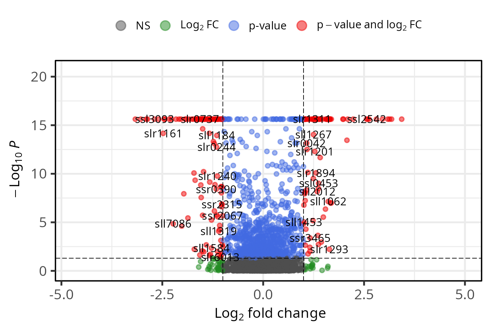

   *Figure 13: An example of the volcano plot generated by TMA.*

6. When the design has a `batch` column, a **Batch effects** tab shows how batch was handled in each study and two diagnostic plots, each before and after the correction:
   - a PCA of each study (computed separately per study on its 500 most variable genes), coloured by batch: after a successful correction, the samples should no longer separate by batch;
   - a relative log expression (RLE) plot: for each sample, the distribution of each gene's log expression minus the gene's median in the study. Boxes centred on 0 and of similar width indicate comparable samples.

### 6.3 DEGs Table & Count Plots

An interactive table (Figure 14a) of all the genes analyzed in the meta-analysis is created with the `DT` package. This table shows gene names, test statistic, raw *p*-values and adjusted *p*-values, along with a column that marks the meta-analysis DEGs with 'yes' and all other genes with 'no'. The table can be sorted and searched to facilitate data exploration and extraction, and it can be downloaded as a CSV file for further analysis. To see the counts of a gene, highlight its row: the app draws a plot (Figure 14b) of the counts of that gene under the two compared conditions in each study included in the analysis. These plots can help examine dosage effects on changes in the expression level of the gene.

| (a) Table of DE analysis results | (b) Plots of counts |
|---|---|
| 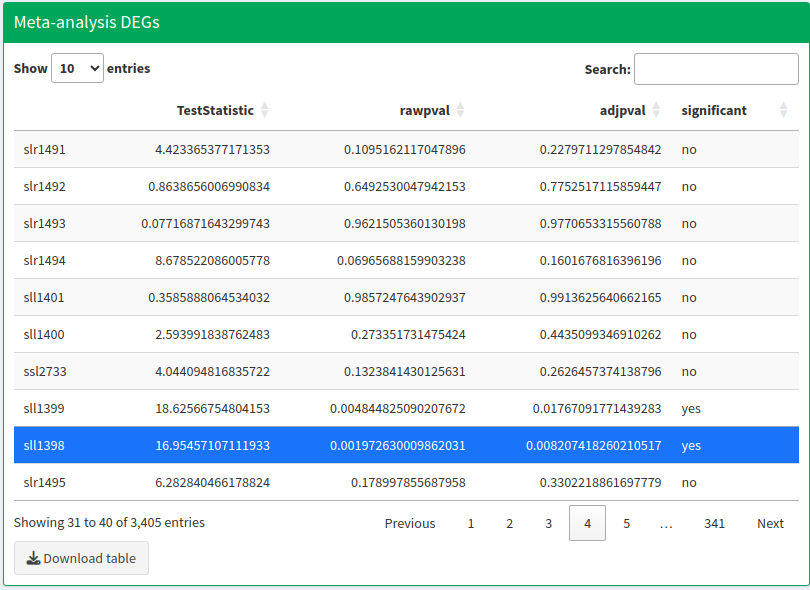 | 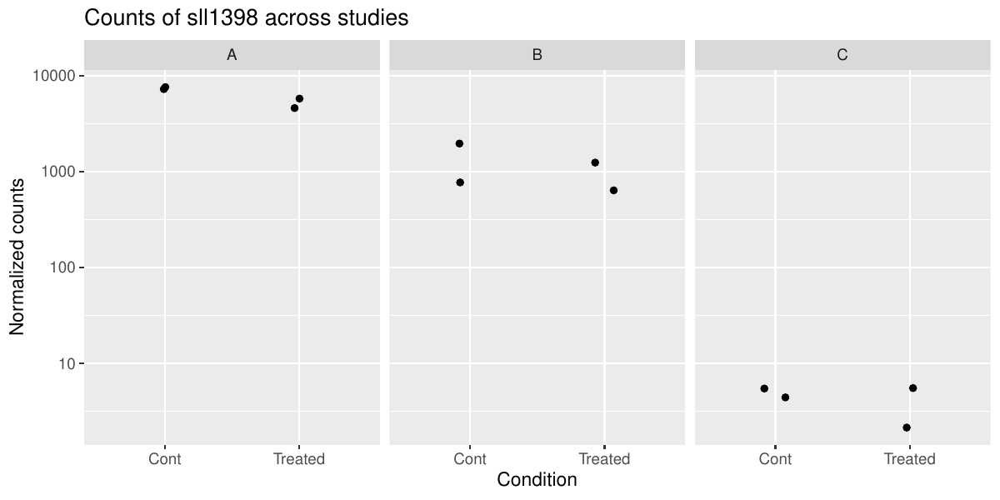 |

*Figure 14: The genes analyzed in the meta-analysis are shown in an interactive table (a), which lets users, for example, search for specific genes or significant ones. Highlighting a row of the table creates a plot (b) of the normalized counts of the highlighted gene across all the studies included in the meta-analysis.*

### 6.4 Functional Annotation

If the user performs functional annotation of the meta-analysis DEGs via GO and KEGG pathway enrichment analyses, the app generates two outputs for each analysis. First, all the enriched GO terms or KEGG pathways are listed and available for download as a file. Second, the enriched terms are shown in a lollipop figure that can also be downloaded as a PDF file. If there are more than 30 enriched GO terms or KEGG pathways, only the 30 with the lowest FDR values are plotted (Figure 15).

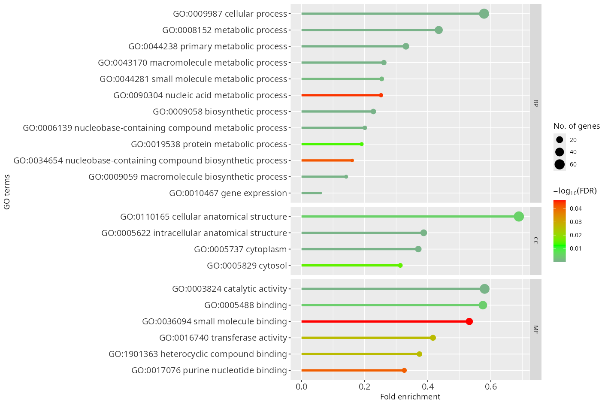

*Figure 15: Enriched GO terms of the demo meta-analysis DEGs shown as a lollipop figure. If there are more than 30 enriched terms or pathways, the 30 with the lowest FDR values are drawn.*

## References

1. Abdel-Salam, E. M., Figueroa-Gonzalez, T. & Leister, D. Transcriptomic meta-analysis and functional validation identify genes linked to adaptation and involved in high-light acclimation in *Synechocystis* sp. PCC 6803. *Frontiers in Photobiology* **1**, (2023).
2. Paul, J. & Barari, M. Meta-analysis and traditional systematic literature reviews—What, why, when, where, and how? *Psychology & Marketing* **39**, 1099–1115 (2022).
3. Rau, A., Marot, G. & Jaffrézic, F. Differential meta-analysis of RNA-seq data from multiple studies. *BMC Bioinformatics* **15**, (2014).
4. Love, M. I., Huber, W. & Anders, S. Moderated estimation of fold change and dispersion for RNA-seq data with DESeq2. *Genome Biology* **15**, (2014).
5. Fisher, R. A. Statistical methods for research workers. in *Breakthroughs in statistics: Methodology and distribution* (eds. Kotz, S. & Johnson, N. L.) 66–70 (Springer New York, New York, NY, 1992). doi:10.1007/978-1-4612-4380-9_6.
6. Mi, H. *et al.* Protocol update for large-scale genome and gene function analysis with the PANTHER classification system (v.14.0). *Nature Protocols* **14**, 703–721 (2019).
7. Wu, T. *et al.* clusterProfiler 4.0: A universal enrichment tool for interpreting omics data. *The Innovation* **2**, 100141 (2021).
8. Galili, T., O'Callaghan, A., Sidi, J. & Sievert, C. Heatmaply: An R package for creating interactive cluster heatmaps for online publishing. *Bioinformatics* **34**, 1600–1602 (2017).
9. Chen, Y., Lun, A. T. L. & Smyth, G. K. From reads to genes to pathways: differential expression analysis of RNA-Seq experiments using Rsubread and the edgeR quasi-likelihood pipeline. *F1000Research* **5**, 1438 (2016).
10. Law, C. W., Chen, Y., Shi, W. & Smyth, G. K. voom: precision weights unlock linear model analysis tools for RNA-seq read counts. *Genome Biology* **15**, R29 (2014).
11. Ritchie, M. E. *et al.* limma powers differential expression analyses for RNA-sequencing and microarray studies. *Nucleic Acids Research* **43**, e47 (2015).
12. Schurch, N. J. *et al.* How many biological replicates are needed in an RNA-seq experiment and which differential expression tool should you use? *RNA* **22**, 839–851 (2016).
13. Zhang, Y., Parmigiani, G. & Johnson, W. E. ComBat-seq: batch effect adjustment for RNA-seq count data. *NAR Genomics and Bioinformatics* **2**, lqaa078 (2020).
