# TranscriptMetaAnalyst (TMA) User Manual

**Eslam M. Abdel-Salam**¹

¹ Plant Molecular Biology, Faculty of Biology, Ludwig-Maximilians-Universität München, Munich, Germany

> TranscriptMetaAnalyst (TMA) is a graphical user interface to meta-analyze RNA-Seq and microarray transcriptomics data. It is designed to help biologists with less programming skills to perform meta-analysis of several transcriptomic data sets in order to get robust results and new insights into the data that was generated by their own studies or the data available online.

*This manual describes the current development version; the PDF version (`TMA_Manual.pdf`) is generated from it. The changes since the first version are listed in [What is new in this version](#what-is-new-in-this-version).*

## Table of contents

- [What is new in this version](#what-is-new-in-this-version)
- [1 Introduction](#1-introduction)
- [2 Installation](#2-installation)
- [3 Quick Start](#3-quick-start)
- [4 App Layout](#4-app-layout)
  - [4.1 Home Tab](#41-home-tab)
  - [4.2 RNA-Seq Meta-Analysis](#42-rna-seq-meta-analysis)
  - [4.3 Microarray Meta-Analysis](#43-microarray-meta-analysis)
  - [4.4 Methods Guide](#44-methods-guide)
  - [4.5 User Manual](#45-user-manual)
- [5 Analysis Pipeline](#5-analysis-pipeline)
- [6 Outputs](#6-outputs)
  - [6.1 Overview & Information Boxes](#61-overview--information-boxes)
  - [6.2 Main Plots](#62-main-plots)
  - [6.3 DEGs Table & Count Plots](#63-degs-table--count-plots)
  - [6.4 Functional Annotation](#64-functional-annotation)
  - [6.5 Reproducible Analysis](#65-reproducible-analysis)
- [References](#references)

## What is new in this version

Several of these changes fix errors in the results of earlier versions, so results produced with an earlier version (PCA, heatmap, volcano plot and GO/KEGG enrichment) should be regenerated. The others make the app faster and easier to use.

| Area | Change |
|------|--------|
| Heatmap | The heatmap values are now attached to the correct gene and sample. Earlier versions could place values in the wrong cells. The heatmap no longer fails when the meta-analysis finds fewer DEGs than there are samples. |
| Heatmap clusters | A new **Number of gene clusters** input (default 2) sets how many clusters the genes are split into, both in the interactive heatmap and in the downloaded PDF. |
| PCA | The PCA now uses the correct normalized counts for every sample. Earlier versions mixed values between genes and samples. |
| Volcano plot | The x-axis now shows the correct mean log2 fold change of each gene across studies. Very small *p*-values are now kept exact, so the most significant genes are drawn at their real height instead of on a flat line at the top of the plot. |
| GO / KEGG enrichment | Enrichment is now run on the meta-analysis DEGs only (significant in the meta-analysis *and* changed in the same direction in every study). Earlier versions used every gene with a consistent direction, whether significant or not. |
| Enrichment background and ID types | The enrichment now compares the DEGs with **all genes tested** in the analysis (the background) instead of the whole genome, which avoids enrichment of terms only because the tested genes differ from the genome. The user states the ID type of the counts file, a new **STRING** tab covers more than 12,000 organisms and most ID types, and every result shows an **ID-mapping report** and the service version. See [Functional Annotation](#64-functional-annotation). |
| Closing the app | When the app is started with `runTMA()`, it stops when its browser window is closed, as before. When it is deployed on a Shiny Server, closing one browser window no longer shuts the app down for all other users. |
| Methods | Besides DESeq2, the differential expression can now be run with edgeR or limma-voom, for all studies or chosen per study. Besides Fisher's method, the *p*-values can be combined with the inverse-normal method. See [Analysis settings](#422-analysis-settings). |
| Batch effects | The experimental design file can have an optional `batch` column. Batch can be added to the DE model (`~ batch + condition`) or removed from the raw counts with ComBat-seq, and the PCA and heatmap can use batch-corrected values. A **Check for batch effects** box detects batch effects before the analysis, and a **Batch effects** results tab shows PCA and RLE plots before and after the correction. See [Batch effects](#423-batch-effects). |
| Several conditions | The design can now have more than two conditions. Every condition is compared with a reference condition (all vs. reference), and each comparison gets its own results tab. See [Analysis settings](#422-analysis-settings) and [Study requirements](#424-study-requirements). |
| Replicate rule | A condition with fewer than 2 samples in a study is left out of that study, and a comparison is meta-analysed only if at least 2 studies remain. The app names the studies and comparisons it left out. See [Study requirements](#424-study-requirements). |
| Plot options | The heatmap and volcano plot have display options (which DEGs to show, top-N genes, gene labels and names, colours, clustering, cutoffs), and every plot can be downloaded as PDF, PNG or TIFF at a chosen size. These options change only the plots, never the DEGs. See [Main Plots](#62-main-plots). |
| Reproducible analysis | A **Download reproducible analysis (ZIP)** button gives a ready-to-run bundle with the data, a setup script that installs the same TMA release, the analysis script with every setting (including the plot options and enrichment choices) and the results of the run. A **Download R script** button gives the script alone. See [Reproducible Analysis](#65-reproducible-analysis). |
| Speed | The studies are analysed in parallel, and an uploaded analysis runs in the background, so the app stays responsive while it runs. The **Start Analysis!** button is disabled until the running analysis has finished. |
| Microarrays | A new **Microarray Meta-Analysis** tab meta-analyses normalised single-colour microarray data, uploaded as one expression file per study or imported directly from GEO. Values are log2-transformed when needed, probes are collapsed to genes, the genes measured in every study are kept, and each study is analysed with limma. A microarray demo (low-CO2 response of *Synechocystis*) is included. See [Microarray Meta-Analysis](#43-microarray-meta-analysis). |
| Methods Guide | A new **Methods Guide** tab explains when to use which differential expression, meta-analysis, batch and enrichment method, lists the study requirements, and gives the references. See [Methods Guide](#44-methods-guide). |
| Demo | The **RNA-Seq Meta-Analysis** tab has a **Load demo data** button, like the microarray tab: the demo data are analysed with the current settings and give the same results as your own data would. The separate *Run Demo Analysis* tab was removed. See [Demo data](#425-demo-data). |
| Low-count genes | Genes with too few reads in every study are removed before the analysis (see [Analysis Pipeline](#5-analysis-pipeline)). They no longer appear in the results table. |
| Downloads | The downloaded DEG list of each study now has the columns `gene`, `base_mean`, `log2_fc`, `lfc_se`, `stat`, `pvalue` and `padj`. The GO results table can be downloaded again (this download failed in earlier versions). |

## 1 Introduction

Meta-analysis of RNA-Seq transcriptomics data has become an essential tool in modern biology to identify differentially expressed genes (DEGs) and pathways across multiple studies [1, 2]. However, performing meta-analysis can be a challenging task, especially for biologists with limited programming skills. To address this issue, we have developed the TranscriptMetaAnalyst (TMA) app, a graphical user interface (GUI) designed to facilitate the meta-analysis of RNA-Seq transcriptomics data.

TMA allows users to easily combine and analyze multiple RNA-Seq datasets, providing a robust and reliable way to identify differentially expressed genes and pathways. The app is built on top of the popular R programming language and uses the metaRNASeq package [3] to perform the meta-analysis. With TMA, users can upload their own RNA-Seq data or use publicly available datasets along with a simple experimental design file, and run the whole analysis with a single click to get publication-ready figures and tables.

TMA is particularly useful for researchers who want to:

- Identify differentially expressed genes and pathways across multiple studies
- Combine data from different studies to increase statistical power
- Visualize the results of the meta-analysis using different methods, e.g., heatmaps and volcano plots

By providing a user-friendly interface to perform meta-analysis, TMA aims to facilitate the discovery of new insights and robust results in transcriptomics research.

**Scope.** TMA does a **gene-level** meta-analysis of **bulk RNA-seq** data (raw read counts per gene) and of **single-colour microarray** data (normalised expression per probe or gene). In each study, every condition is compared with a reference condition, and the per-gene *p*-values of the studies are combined. Transcript-level, isoform and alternative-splicing analyses are out of scope: the input must hold one value per gene (RNA-seq) or per probe that is collapsed to its gene (microarrays). RNA-seq and microarray studies are analysed in separate tabs and are not combined in one meta-analysis.

## 2 Installation

The app can be installed locally from [GitHub](https://github.com/Eabdelsalam/TranscriptMetaAnalyst) with the following commands (the `BiocManager` and `devtools` packages should be installed before installing the app):

```r
# Check if devtools and BiocManager are installed, and install them if not
if (!requireNamespace("devtools", quietly = TRUE))
  { install.packages("devtools") }
if (!requireNamespace("BiocManager", quietly = TRUE))
  { install.packages("BiocManager") }
# Now you can use devtools to install the ShinyApp
devtools::install_github("Eabdelsalam/TranscriptMetaAnalyst")
# Finally, run the app
library(TranscriptMetaAnalyst)
runTMA()
```

When started with `runTMA()`, the app stops automatically when its browser window is closed. When the app is deployed on a Shiny Server, it keeps running for other users when one user closes their window.

## 3 Quick Start

To start the RNA-Seq meta-analysis, click on the **RNA-Seq Meta-Analysis** tab and perform the following steps (to try the app first, click **Load demo data** on that tab):

- After cleaning the raw RNA-Seq read files (either downloaded from public databases or generated in your own experiments) of each sample, align them individually to the studied organism's reference genome.
- Count the mapped reads for the genomic features of interest and combine all the counts in one file, keeping genomic features as rows and the samples that will be included in the analysis as columns. This produces the final raw (unnormalized) counts file. ***Note that the counts file should have a 'Geneid' column.***
- Upload the counts file produced by any feature counting tool, e.g., featureCounts or htseq-count, to the raw counts input of the *RNA-Seq data* box. ***Please refer to the example counts file via the provided download link.***
- Upload the experimental design file. ***Please refer to the example file via the provided download link.*** This file should contain at least 3 columns: 'sample' refers to the sample names used as columns in the counts file, 'study' refers to the study to which the sample belongs, and 'condition' refers to the treatment or control conditions. With more than two conditions, each one is compared with the reference condition chosen in the **Analysis settings** box.
- Optionally, choose the differential expression and meta-analysis methods in the **Analysis settings** box (the defaults are DESeq2 and Fisher's method).
- Hit the ***Start Analysis!*** button and wait for the results to appear.
- To perform further **Functional Annotation** of the DEGs identified via the meta-analysis, use the functional annotation box in the bottom-left corner of the page. The user needs to choose the organism before performing this analysis. This analysis needs an active internet connection and might take a while.

## 4 App Layout

### 4.1 Home Tab

After running TMA, the layout shown in Figure 1 opens in a separate window. The top left corner holds the app name. The left panel holds the different tabs that form the core of the app and its functionality. The three-bar symbol beside the app name toggles the side panel on and off. The **Home** tab opens by default when the app starts and contains brief information about the app and its components.


*Figure 1: Layout of the TranscriptMetaAnalyst app. The app opens the home tab by default, showing brief information about the app and how to use it.*

### 4.2 RNA-Seq Meta-Analysis

This tab contains everything needed to perform a meta-analysis of RNA-Seq data (Figure 2). It has the same layout as the Microarray Meta-Analysis tab: the **Analysis settings** box at the top, then the **RNA-Seq data** box with the **Load demo data** button (see [Demo data](#425-demo-data)), the inputs for the two required files (discussed below) with links to example (template) files, a short description of the files and the **Start Analysis!** button, and then the **Check for batch effects** box. The results appear below these boxes.


*Figure 2: The RNA-Seq Meta-Analysis tab, where users analyze their own data or the demo data.*

#### 4.2.1 Input Files

To perform a meta-analysis of RNA-Seq data using TMA, the user needs two input files:

1. The ***raw counts file***: a tab-delimited file that contains the raw counts of all the experiments to be analyzed, where each row represents a single gene and each column represents all counts from a single sample. Figure 3 shows an example of the raw counts file.

2. The ***experimental design file***, which should contain at least 3 columns: sample, study, and condition. An example of this file is shown in Figure 4. The study column should contain records for all the count columns in the raw counts file. The condition column should contain at least two conditions; each condition is compared with the reference condition (see [Analysis settings](#422-analysis-settings)), and each needs at least 2 samples in a study (see [Study requirements](#424-study-requirements)). An optional fourth column, `batch`, gives the batch of each sample within its study (for example the sequencing run or library preparation date); see [Batch effects](#423-batch-effects).


*Figure 3: An example of the raw counts file needed for the analysis. Note that the file contains a 'Geneid' column.*


*Figure 4: An example of the experimental design file. This example file contains the three required columns only.*

#### 4.2.2 Analysis settings

The **Analysis settings** box at the top of the tab sets how the data are analysed:

- **Reference condition**: once the experimental design file is uploaded, this drop-down lists its conditions. Every other condition is compared with the reference ("all vs. reference"); with two conditions this is the usual "treated vs. control" comparison. The app pre-selects a condition whose name looks like a control (control, ctrl, cont, wt, wild type, mock, untreated), otherwise the first condition in alphabetical order. Each study is fitted once with all its conditions, and every comparison is taken from that fit.
- **Differential expression method**, used in each study: DESeq2 (default) [4], edgeR (quasi-likelihood F-test) [9] or limma-voom [10, 11].
- **DE method per study (optional)**: once the experimental design file is uploaded, one drop-down per study lets you use a different method for that study. "Same as above" uses the method chosen for all studies.
- **Meta-analysis method**: Fisher's method [5] (default) or the inverse-normal method [3], which weights each study by the square root of its number of samples.

The **Which method should I use?** link in the box gives a short guide:

- DESeq2 and edgeR both model counts with a negative-binomial distribution and work well with few replicates per group; in a benchmark with few replicates they were among the best-performing tools [12].
- limma-voom fits linear models on log-counts with precision weights. It is fast and a good choice for larger studies or when library sizes differ a lot.
- Fisher's method can make a gene significant on the strength of a single study.
- The inverse-normal method favours genes with consistent evidence across studies and gives larger studies more weight.

Changes take effect the next time **Start Analysis!** is clicked. The methods used are shown in the *Number of studies* box of the results.

#### 4.2.3 Batch effects

The **Analysis settings** box of the RNA-Seq tab has three batch options. The first two need a `batch` column in the experimental design file; if it is missing, the analysis does not start and a message asks you to add the column or choose **Ignore batch**. Batch is handled within each study:

- **Batch in the DE model (~ batch + condition)** (recommended when there is a batch column): the batch effect is estimated together with the condition effect, so the *p*-values take it into account. The counts are not changed.
- **ComBat-seq on the raw counts**: the raw counts of each study are corrected for batch with ComBat-seq [13], keeping the condition effect, and then analysed with `~ condition`. The DE test then treats the corrected counts as raw data and does not account for the estimated batch effects, which can make *p*-values too small in small studies [14]. ComBat-seq also needs at least two samples in every batch.
- **Ignore batch** (default): the `batch` column, if any, is not used.
- **Use batch-corrected values in the PCA and heatmap** (also needs a `batch` column): draws these two plots from batch-corrected values (the ComBat-seq counts if ComBat-seq was used, otherwise values from `limma::removeBatchEffect()` [11]). This option only changes the plots, not the DE analysis.

Batch can only be used in a study that has at least two batches, whose batches are not confounded with the condition, and that keeps enough samples to estimate the model. A study that does not meet these conditions is analysed with `~ condition`, and the **Batch effects** tab of the results names the study and the reason.

**Detecting batch effects before the analysis.** The **Check for batch effects** box, below the *RNA-Seq data* box, looks at the data before any differential expression analysis. Click **Check for batch effects** after uploading the two files (or after **Load demo data**). For each study it:

- computes a PCA of the log2 normalised counts (500 most variable genes) and reports how much of the variance of the first principal components is explained by the condition and, if the design has a `batch` column, by the batch;
- gives advice: a study is flagged when batch explains as much variance as condition or more (consider **Batch in the DE model** or ComBat-seq), or when batch is confounded with condition. Without a `batch` column, it warns when the first principal component carries a large share of the variance (30% or more) but is not explained by the condition, which can point to an unrecorded batch effect;
- shows the PCA and RLE plots of each study (described in [Main Plots](#62-main-plots)).

These flags are guides for looking at the plots, not statistical tests.

#### 4.2.4 Study requirements

TMA applies these rules to every analysis:

- **At least 2 samples (replicates) per condition in a study.** A condition with fewer than 2 samples in a study is removed from that study: its samples are not used, and the study is left out of the comparisons that involve that condition. A study with fewer than 2 samples of the reference condition is not used at all.
- **At least 2 studies per comparison.** A comparison (e.g. *Heat vs Control*) is meta-analysed only if at least 2 studies still have both conditions with at least 2 samples each. Otherwise the comparison is not meta-analysed, and the app says why.
- **At least one comparison.** If no comparison can be meta-analysed, the analysis stops with a message that explains why.
- **Gene-level IDs.** All studies must use the same type of gene ID, so that genes can be matched across studies. For RNA-Seq, all studies are in one counts file and share its `Geneid` column; for microarrays, only the genes measured in every study are kept (see [Data preparation](#432-data-preparation)).
- **Supported ID types for the enrichment.** The ID type of the genes is chosen in the *Functional Annotation* tab. The services accept these types:

| ID type | PANTHER (GO) | KEGG | STRING |
|---|---|---|---|
| Gene symbol | yes | no | yes |
| Locus tag / KEGG gene ID | yes | yes | yes |
| NCBI Entrez Gene ID | yes | yes | yes |
| UniProt accession | yes | yes | yes |
| Ensembl gene ID | yes | no | yes |

After each run, a message lists the studies and comparisons that were left out (for example, "Study S2 has only 1 sample of 'Heat' (at least 2 are needed), so it is not used for 'Heat vs Control'"), and the **Comparisons** box at the top of the results shows how many studies each comparison used.

#### 4.2.5 Demo data

The **Load demo data** button in the *RNA-Seq data* box runs the analysis on the demo data bundled with TMA: simulated counts of *Synechocystis* sp. based on our previously published meta-analysis [1], in three studies (A, B and C), each with two control (`Cont`) and two treated (`Treated`) samples. These are the same data as the example files. A message shows that the analysis is running, and after a while the full set of results described in [Outputs](#6-outputs) appears. This lets users try the app and learn how to navigate its results before working with their own data.

The demo uses the methods chosen in the **Analysis settings** box; batch is ignored, because the demo data have no batch column. After the demo, the settings box lists the demo's conditions and studies, so other methods can be chosen and the demo run again with **Start Analysis!**. Uploading a file switches back to the uploaded data. For the enrichment, the ID type (locus tags) and *Synechocystis* are preselected in the *Functional Annotation* box, and the R script of the demo uses the bundled data, so it runs as it is.

### 4.3 Microarray Meta-Analysis

The *Microarray Meta-Analysis* tab does the same meta-analysis for normalised **single-colour** microarray data. It has the same **Analysis settings** box as the RNA-Seq tab, with two differences: every study is analysed with limma (there is no choice of DE method), and batch can be added to the model or ignored (ComBat-seq is for counts and is not offered). The results have the same tabs and downloads as for RNA-Seq data (see [Outputs](#6-outputs)); the PCA, heatmap and expression plots show the log2 expression values.

#### 4.3.1 Input

There are two ways to give the data:

- **Upload files.** One tab-delimited expression file per study (several files can be selected at once; gzip-compressed files are accepted) and one experimental design file. In each expression file, the first column holds the probe (or gene) IDs, an optional column named `Symbol` (or `Gene`, `Gene symbol`) gives the gene each probe measures, and the other columns are the samples, named as in the `sample` column of the design file. The design file is the same as for RNA-Seq data: `sample`, `study`, `condition` and optionally `batch`. Each expression file must hold the samples of one study.
- **Import from GEO.** Type one or more GEO series accessions (e.g. `GSE82120, GSE63352`) and click **Fetch from GEO**. The series matrices and platform annotations are downloaded with GEOquery [16] (an internet connection is needed the first time; the files are then cached on your computer). For each series, choose the platform (if it has several), the sample annotation column that holds the condition, the label of each of its values (leave a value empty to drop those samples), and the platform column that holds the gene. The study name is the GSE accession.

Only single-colour arrays can be used. For two-colour arrays (two channels per sample, or single channels labelled with both Cy3 and Cy5), the app shows a warning, because their channels are not comparable as independent samples.

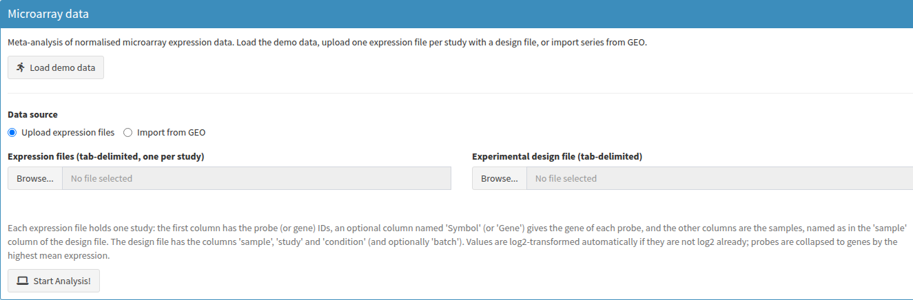

*Figure 5: The Microarray data box of the Microarray Meta-Analysis tab, with the demo button and the two ways to give the data (upload or GEO import).*

#### 4.3.2 Data preparation

Before the analysis, every study goes through these steps, and the **Data preparation** box reports the numbers of samples, probes, dropped probes and genes per study:

1. **log2 transformation if needed.** The app uses the rule of GEO2R: the values are considered not log-transformed when the 99th percentile is above 100, or when the range is wider than 50 and the 25th percentile is positive. Such data are log2-transformed; values of 0 or less become missing. The *log2 applied* column says whether this was done.
2. **Probes to genes.** When the file has a gene column, probes without a gene and probes that map to several genes (e.g. `geneA /// geneB`) are dropped, and for every gene the probe with the highest mean expression is kept.
3. **Common genes.** Only the genes measured in every study are used in the meta-analysis. The box gives their number.

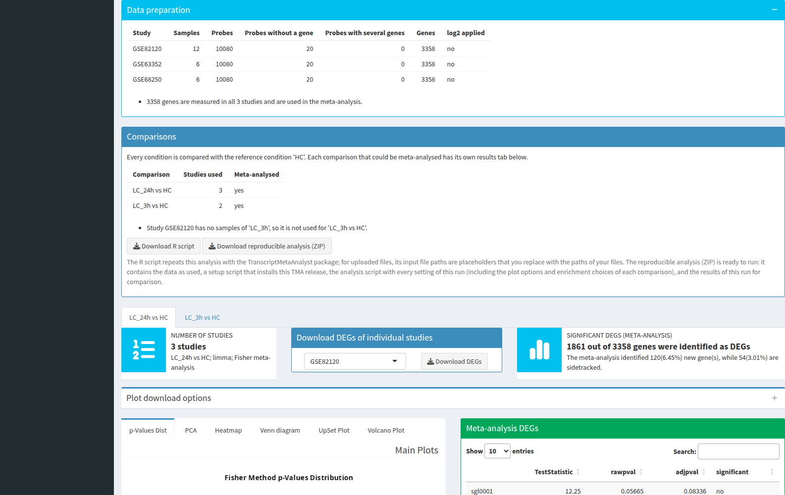

*Figure 6: The Data preparation box after the microarray demo, followed by the Comparisons box of the results.*

#### 4.3.3 Differential expression with limma

Each study is fitted with `~ 0 + condition` (or `~ 0 + condition + batch` when batch is in the model) with `lmFit`, every condition is compared with the reference with `contrasts.fit`, and the statistics are moderated with `eBayes` using an intensity trend (`trend = TRUE`), as recommended for microarray data [11]. The *p*-values of the studies are then combined with Fisher's or the inverse-normal method, as for RNA-Seq data. The [study requirements](#424-study-requirements) are the same: at least 2 samples per condition in a study and at least 2 studies per comparison.

#### 4.3.4 Microarray demo

The **Load demo data** button runs a demo analysis on wild-type *Synechocystis* sp. PCC 6803 grown at high CO2 (`HC`) and 3 h or 24 h after a shift to low CO2 (`LC_3h`, `LC_24h`), from three GEO series on platform GPL15867 (GSE82120, GSE63352 and GSE68250). GSE82120 has no 3 h samples, so *LC_3h vs HC* uses two studies and *LC_24h vs HC* uses three. To keep the package small, each file holds at most 3 probes per gene and a few control probes without a gene, so the demo also shows the probe collapsing.

### 4.4 Methods Guide

The *Methods Guide* tab summarises, on one page, what TMA analyses (its scope), the study requirements and the supported ID types, and when to use which differential expression method (DESeq2, edgeR, limma-voom, and limma for microarrays), meta-analysis method (Fisher or inverse normal), batch handling and enrichment service, with references [3–6, 9–15, 17, 18]. The *Which method should I use?* link in each **Analysis settings** box gives a short version of the same advice.

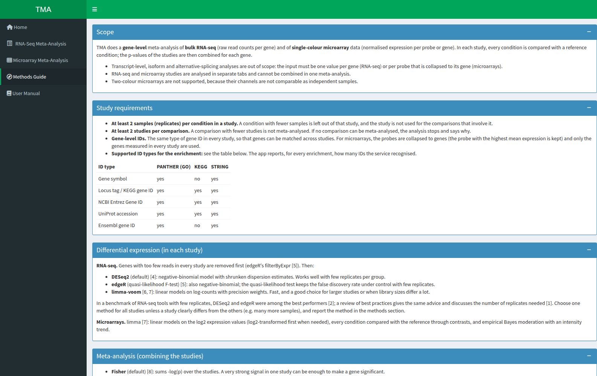

*Figure 7: The Methods Guide tab.*

### 4.5 User Manual

The last tab on the left panel is the *User Manual* tab. It provides a link to the current detailed guide of TMA, information on contacting the creators of the app, and how to cite the app in scientific publications (Figure 8).

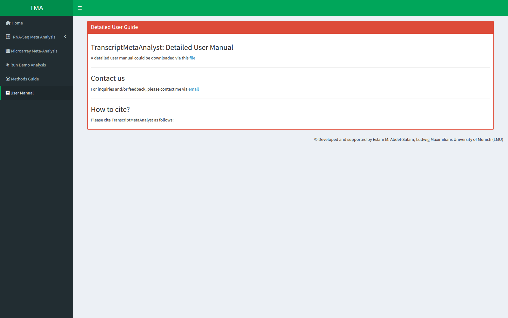

*Figure 8: The User Manual tab of TMA, with links to download the detailed guide and to contact the app's creators, along with citation information.*

## 5 Analysis Pipeline

After uploading the required files, several checks are performed to make sure that the files meet the analysis requirements. The user is notified about any problems in the files and asked to fix them before re-running the analysis.

If the files pass the checks, the analysis starts automatically and a loading screen appears until the results are ready. Behind the scenes:

1. Genes with too few reads are removed with the `filterByExpr` function of the edgeR package [9]. A gene is kept for all studies if it has enough reads in at least one study; genes that are low in every study are removed. Within each study, DESeq2's own filtering still handles genes that are low there.
2. DEGs are identified in each study separately with the chosen method: DESeq2 [4], edgeR [9] or limma-voom [10, 11]. The studies are analysed in parallel. Whatever the method, the plots (PCA, heatmap, count plots) use DESeq2-normalised counts, so they look the same for every method.
3. The raw *p*-values of the studies are combined with Fisher's method [5] or the inverse-normal method via the metaRNASeq package [3], and the combined *p*-values are adjusted with the Benjamini–Hochberg method. Genes with an adjusted meta-analysis *p*-value ≤ 0.05 are significant.
4. As a validation step, genes with conflicting directions (up-regulated in one study and down-regulated in another) are removed. The remaining significant genes are the **meta-analysis DEGs**. They are used for the heatmap, the Venn/UpSet plots and the functional annotation.

If the user would like to perform further functional annotation of the identified DEGs, Gene Ontology (GO), KEGG pathway and STRING enrichment analyses can be run on the **meta-analysis DEGs**, compared with all genes tested in the analysis (the background). No organism database is installed: the online services map the gene IDs themselves. First, the user states the **gene ID type** of the counts file (gene symbol, locus tag / KEGG gene ID, NCBI Entrez Gene ID, UniProt accession or Ensembl gene ID) in the *Enrichment input* box. Then:

- **Gene Ontology** (PANTHER [6], via the `rbioapi` package): choose the organism from the searchable list of the ~140 PANTHER organisms (Figure 9a). PANTHER recognises most ID types.
- **KEGG pathway** (clusterProfiler [7], via the KEGG REST service): type the KEGG code of the organism, found in the [KEGG Organisms Database](https://www.genome.jp/kegg-bin/get_htext?br08601) (Figure 9b). The app checks the code as you type and names the organism. KEGG accepts locus tags / KEGG gene IDs, NCBI Entrez Gene IDs and UniProt accessions; for gene symbols or Ensembl IDs the app explains this and suggests the STRING or Gene Ontology tab.
- **STRING** [15] (via `rbioapi`): choose the organism from the searchable list of the more than 12,000 STRING organisms. STRING recognises gene symbols, locus tags, UniProt and most other IDs, and tests GO, KEGG, Reactome, Pfam, InterPro and other annotation sources at once. It is the fallback for organisms or ID types that PANTHER or KEGG do not cover.

If the meta-analysis found no DEGs, the app shows a message instead of running the enrichment. If a service cannot be reached or returns an error, the app shows a message (for example, to check the internet connection) instead of stopping.

| (a) GO Enrichment | (b) KEGG Pathway Enrichment |
|---|---|
| 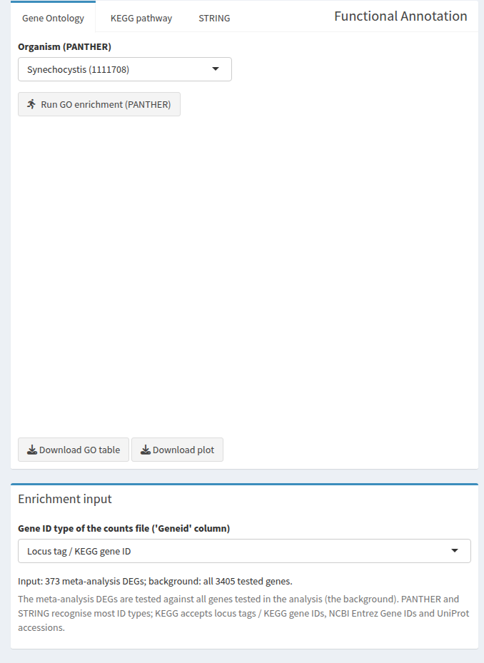 | 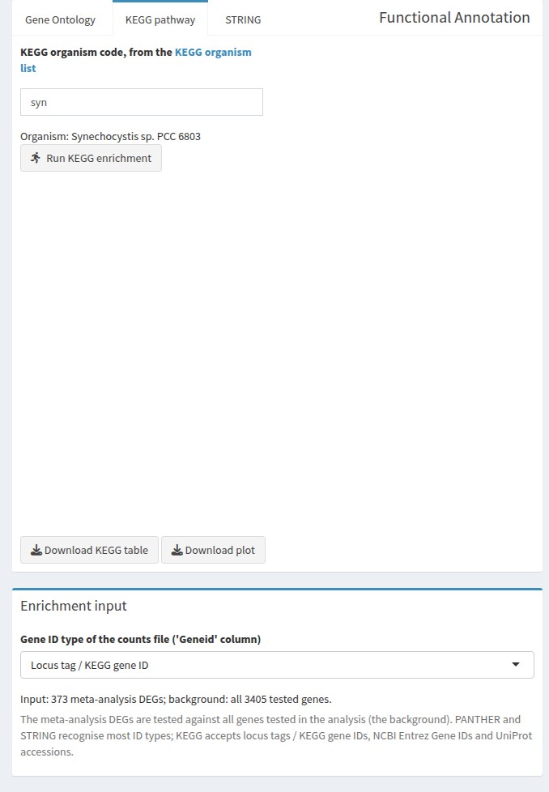 |

*Figure 9: The Functional Annotation box with its Gene Ontology (GO), KEGG pathway and STRING tabs, and the gene ID type selector. The user should (a) select the organism from the drop-down menu before running the GO analysis or (b) type the code of the studied organism before running the KEGG pathway analysis.*

The same analysis can also be run from R without the app, for example to reproduce or extend the results (the app can write such a script for you, see [Reproducible R Script](#65-reproducible-analysis)):

```r
library(TranscriptMetaAnalyst)
counts <- read_tma_table("counts.txt")
design <- read_tma_table("design.txt")
res <- run_tma_pipeline(counts, design, de_method = "edgeR", meta_method = "invnorm")
res$meta_degs              # meta-analysis DEGs
plot_volcano(volcano_data(res))
```

Finally, the different outputs (discussed in the next section) are produced with in-house scripts along with built-in functions and other R packages. The outputs are grouped and shown in different boxes. All the figures can be downloaded as PDF, PNG or TIFF files and the tables as CSV files.

## 6 Outputs

### 6.1 Overview & Information Boxes

On the RNA-Seq tab, the results start with a **Comparisons** box that lists every comparison (condition vs. reference), how many studies it used, whether it was meta-analysed, and which studies were left out and why. Below it, each comparison that was meta-analysed has its own tab with the boxes described here; everything in a tab (plots, tables, enrichment, downloads) refers to that comparison. The download file names start with the comparison, e.g. `rnaseq_Heat_vs_Cont_pca.pdf`.

TMA provides the user with 7 main output boxes (Figure 10). At the top of the results screen, two information boxes on the left and right show the number of studies included in the analysis and the number of DEGs identified via the meta-analysis, respectively; the *Number of studies* box also names the comparison and the methods used. In the middle, a box lets the user download the list of DEGs identified in each individual study.

Below the information boxes, the results screen is divided into 4 main sections. The top left box contains the main plots (discussed below). The top right box contains a table of all genes in the meta-analysis with their statistical parameters. This table can be searched and sorted, and downloaded as a CSV file for further analysis. Clicking on any row of the table updates the Count plots box (bottom right) with plots of the normalized counts of the selected gene across all the studies included in the meta-analysis. These plots can also be downloaded as a PDF file. The bottom left box contains the GO and KEGG pathway enrichment analysis and results (discussed below).

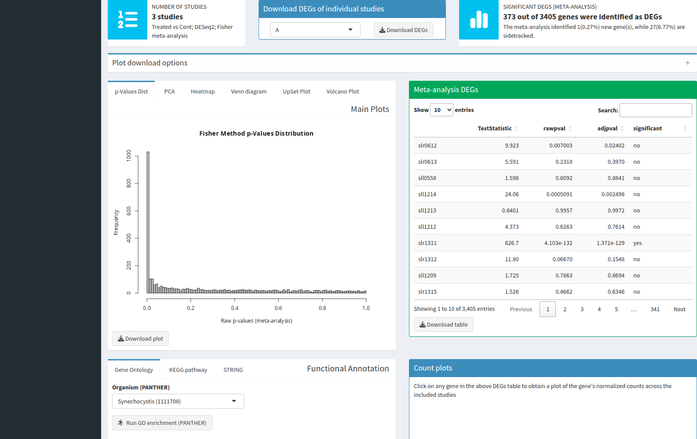

*Figure 10: An overview of the outputs generated by TMA.*

### 6.2 Main Plots

**Download options.** The collapsible **Plot download options** box above the main plots sets the file format (PDF, or PNG or TIFF at 300 dpi) and the width and height in cm for every *Download plot* button of the results tab. Leave the width and height empty to use each plot's default size.

TMA generates several main plots to give the user an overview of the analyzed dataset and the identified DEGs. The figures below were produced from the demo data.

1. The ***p*-values distribution** plot (Figure 11) shows the distribution of all raw meta-analysis *p*-values (its title names the meta-analysis method), so the user can check their distribution. The *p*-value combination method assumes a uniform distribution under the null hypothesis, so no peak other than the one near zero should appear in the distribution.

   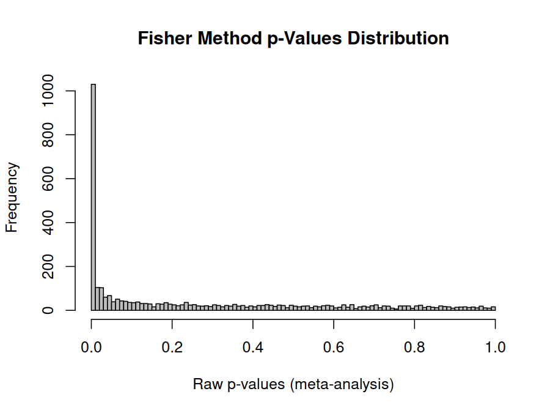

   *Figure 11: The p-values distribution histogram generated by TMA.*

2. The **Principal Component Analysis (PCA)** is performed with the DESeq2 package [4] on the log2-transformed normalized counts of all samples. The figure (Figure 12) can be used to identify the relationship between samples and/or biological replicates, and to identify potential outliers to exclude from the analysis. In the demo data, the first principal component separates the studies, which is expected when studies come from different experiments.

   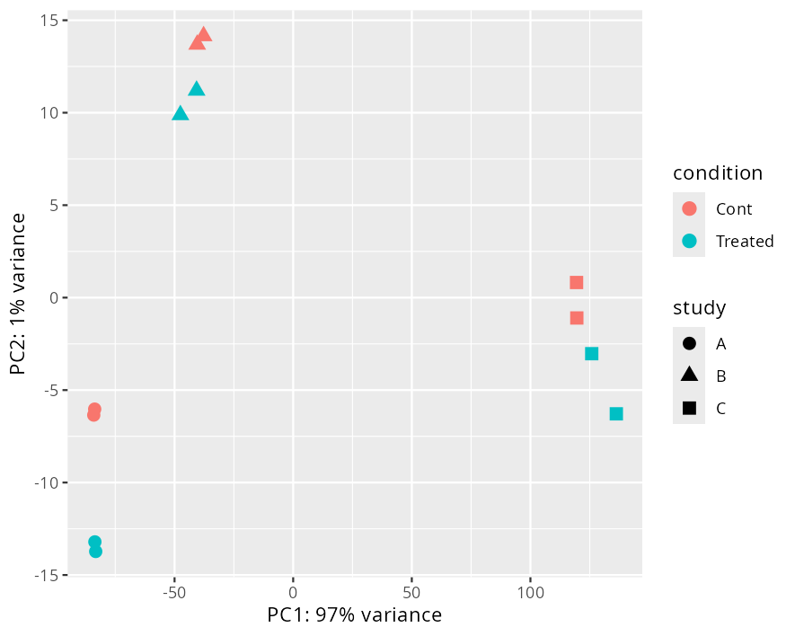

   *Figure 12: An example of the PCA plot generated by TMA.*

3. A **heatmap** (Figure 13) of the normalized counts of the meta-analysis DEGs is generated. The counts of each gene are scaled (z-scores) within each study, so the colours show how a gene changes between the samples of one study. In the TMA GUI, the heatmap is interactive and built with the `heatmaply` package [8]. The genes are grouped by hierarchical clustering. The **Number of gene clusters** box above the heatmap sets how many clusters the genes are split into (default 2, e.g., up- and down-regulated genes). It cannot be larger than the number of genes shown, and an empty or invalid value falls back to 2. **Top N genes** shows only the N DEGs with the smallest adjusted *p*-values (empty shows all). The **More heatmap options** link opens further display options:
   - **Show DEGs with adj. p <=** and **|mean log2FC| >=**: show only the DEGs that pass these cutoffs (by default all meta-analysis DEGs are shown);
   - **Colours**: yellow–black–purple (default), blue–white–red, or viridis;
   - **Clustering method** (complete, average, Ward, single), and **Cluster genes** / **Cluster samples** to switch the clustering of rows or columns off;
   - **Show gene names**.

   These options only change what the heatmap shows; the DEGs, the table and the other plots are not affected. The user can download the figure (not interactive) with the chosen options, or the data used to draw the heatmap for further analysis. A heatmap needs at least two genes; otherwise, a message is shown instead.

   

   *Figure 13: The downloadable (non-interactive) heatmap of the meta-analysis DEGs, split into the default 2 gene clusters.*

4. A **Venn diagram** (Figure 14a) and an **UpSet plot** (Figure 14b) show the intersection of identified DEGs across the analyzed studies and the meta-analysis. A Venn diagram stays readable for at most 4 sets (here up to 3 studies plus the meta-analysis). With more sets, the Venn diagram tab is not shown, and the UpSet plot shows the overlaps.

   | (a) Venn Diagram | (b) UpSet Plot |
   |---|---|
   | 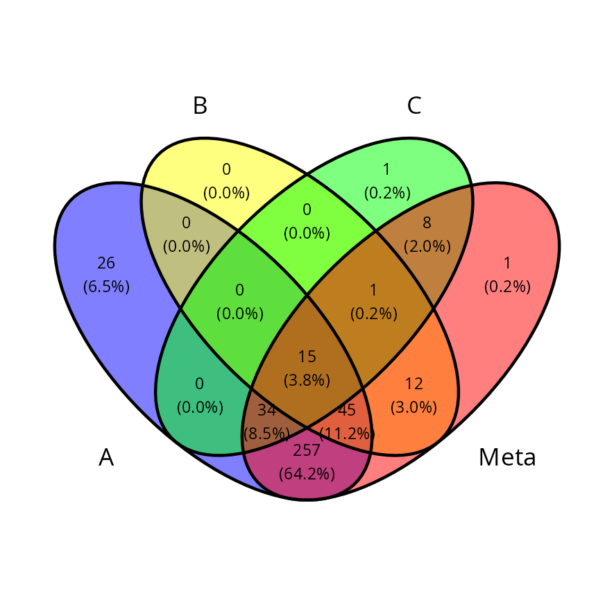 | 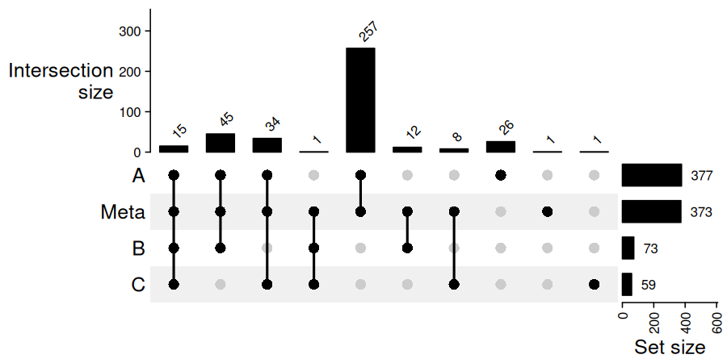 |

   *Figure 14: The intersection of identified DEGs is shown via (a) a Venn diagram, if the number of analyzed studies is 3 or fewer, and (b) an UpSet plot.*

5. A **volcano plot** (Figure 15) shows the adjusted meta-analysis *p*-values (−log10) on the y-axis and the mean log2 fold change of each gene across all studies on the x-axis. It is generated with the `EnhancedVolcano` package. TMA computes the meta-analysis *p*-values so that values far below 10⁻¹⁶ stay exact; in the rare case that a *p*-value is still exactly 0, it is drawn at the height of the smallest non-zero *p*-value. The **Volcano plot options** link sets the adjusted *p*-value and |log2FC| cutoffs drawn on the plot (defaults 0.05 and 1), and which genes are labelled: all genes past both cutoffs (default), the N most significant of them, or none. The cutoff line is labelled with its adjusted *p*-value. Because very small *p*-values make the y-axis long (up to about 220 for the demo), the line can sit close to the bottom; **Y-axis maximum** caps the axis (genes above it are drawn at the top edge, and a note under the plot counts them), which spreads out the region around the cutoff. The figure and the data used to create it are available for download.

   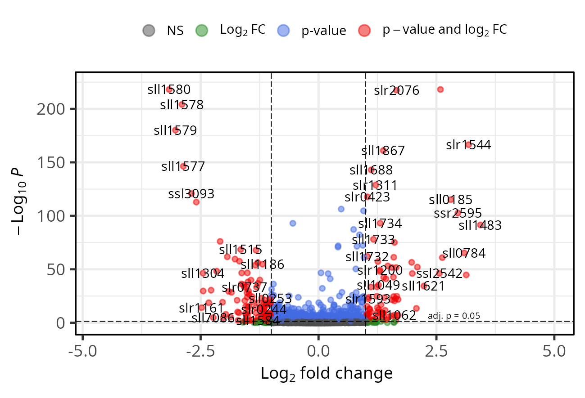

   *Figure 15: An example of the volcano plot generated by TMA.*

6. When the design has a `batch` column, a **Batch effects** tab shows how batch was handled in each study and two diagnostic plots, each before and after the correction:
   - a PCA of each study (computed separately per study on its 500 most variable genes), coloured by batch: after a successful correction, the samples should no longer separate by batch;
   - a relative log expression (RLE) plot: for each sample, the distribution of each gene's log expression minus the gene's median in the study. Boxes centred on 0 and of similar width indicate comparable samples.

### 6.3 DEGs Table & Count Plots

An interactive table (Figure 16a) of all the genes analyzed in the meta-analysis is created with the `DT` package. This table shows gene names, test statistic, raw *p*-values and adjusted *p*-values, along with a column that marks the meta-analysis DEGs with 'yes' and all other genes with 'no'. The table can be sorted and searched to facilitate data exploration and extraction, and it can be downloaded as a CSV file for further analysis. To see the counts of a gene, highlight its row: the app draws a plot (Figure 16b) of the counts of that gene under the two compared conditions in each study included in the analysis. These plots can help examine dosage effects on changes in the expression level of the gene.

| (a) Table of DE analysis results | (b) Plots of counts |
|---|---|
| 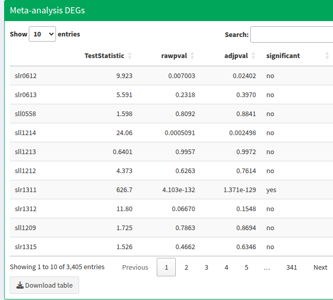 | 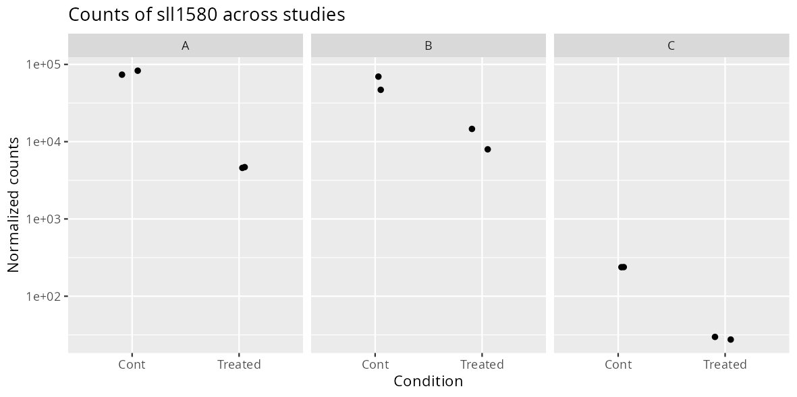 |

*Figure 16: The genes analyzed in the meta-analysis are shown in an interactive table (a), which lets users, for example, search for specific genes or significant ones. Highlighting a row of the table creates a plot (b) of the normalized counts of the highlighted gene across all the studies included in the meta-analysis.*

### 6.4 Functional Annotation

For each enrichment service (Gene Ontology, KEGG pathway, STRING), the app shows:

1. An **ID-mapping report**: how many IDs were submitted, how many the service recognised (mapped) and how many it did not, and the mapping rate, with a link to download the IDs that were not mapped. If fewer than half of the IDs were mapped, a warning suggests checking the ID type or trying another service. For KEGG, "mapped" means "in a KEGG pathway", which is often a minority of all genes; the warning is therefore only given when the DEGs map clearly worse than all tested genes.
2. A **label** with the service, its database version or date, the organism and the background (e.g. "STRING functional enrichment (STRING version 12.0); organism: Synechocystis sp. PCC 6803 (1148); background: all 3405 tested genes (2983 recognised by STRING)"). Report this information together with the results.
3. A **lollipop figure** of the enriched terms (the 30 with the lowest FDR values if there are more), which can be downloaded in the format chosen under *Plot download options*.
4. The **table** of all enriched terms, downloadable as a tab-delimited file that starts with the label and the mapping summary.

Because the background is the set of tested genes, the results can differ from earlier versions, which used the whole genome. For the demo data, PANTHER finds no GO term enriched among the meta-analysis DEGs when they are compared with all tested genes, while STRING finds photosynthesis-related terms (Figure 17).

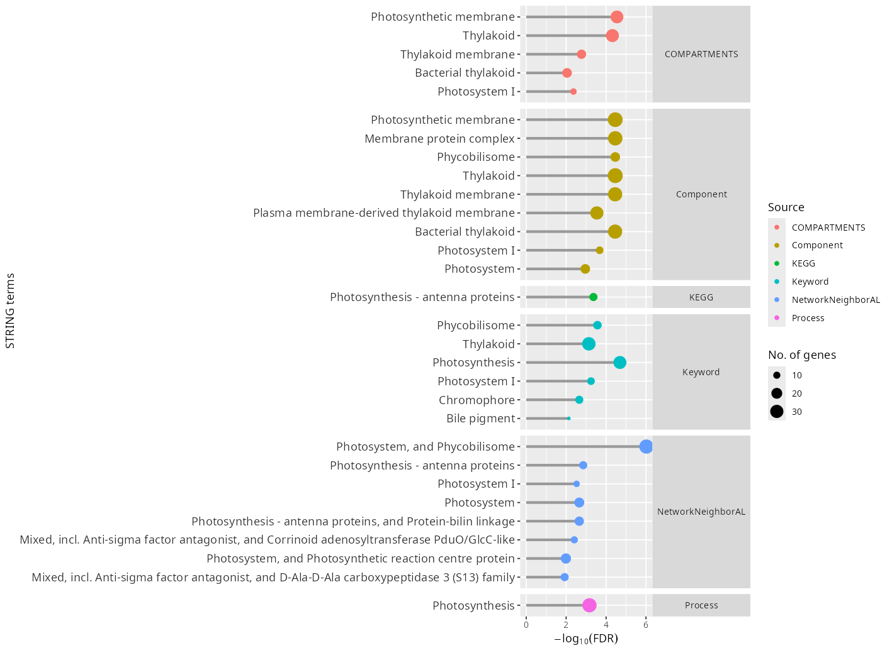

*Figure 17: STRING enrichment of the demo meta-analysis DEGs against all tested genes, shown as a lollipop figure grouped by annotation source. Publications (PMID) are listed in the table but not drawn.*

### 6.5 Reproducible Analysis

The *Comparisons* box of the RNA-Seq and Microarray tabs has two buttons to repeat an analysis outside the app.

**Download reproducible analysis (ZIP)** gives a ready-to-run folder, `tma_analysis_<date>.zip`, with the code, setup and data of this analysis:

| File | Content |
|---|---|
| `README.md` | What the bundle is, the TMA version (and the commit, for a GitHub installation), how to run it and the expected run time. |
| `setup.R` | Checks the R version, installs BiocManager and the same TMA release (`BiocManager::install("Eabdelsalam/TranscriptMetaAnalyst@v<version>")`), and lists every package whose installed version differs from the original run. |
| `analysis.R` | Repeats the analysis with **every** setting of the run: the analysis methods, the plot display options of each comparison (heatmap and volcano options, figure format and size) and the enrichment choices (ID type, organisms; the services that were run are run again). It reads `data/` with relative paths and writes to `rerun/`. |
| `settings.json` | Every analysis and display setting, machine-readable. |
| `data/` | The input exactly as used: the counts and design files (RNA-Seq), one expression file per study and the design (microarrays), or, for GEO imports, the extracted expression tables, the downloaded series files and the sample-to-condition mapping, so the bundle runs offline. |
| `results/` | The tables and figures of this run. |
| `session_info.txt` | R and package versions of this run. |

To run it, unzip the file and, in the `tma_analysis` folder, run `Rscript setup.R` once and then `Rscript analysis.R`. `rerun/` gets the same files as `results/`; the tables are identical when the package versions match, so the results can be checked. Enrichment results need an internet connection and can change when a service updates its database.

**Download R script** gives only the analysis script, for the methods section or for re-running the analysis on your own copy of the data. It is the same script as `analysis.R` (with the same settings and plot options), but it reads the input from wherever you keep it: **for your own data, the file paths in the script are placeholders** (`PATH/TO/<file name you uploaded>`), because the app does not know where the files are on your computer. A banner at the top of the script and a note under the button say so; replace the paths before running the script. The demo script uses the demo data bundled with the package and runs as it is; for GEO studies, the script downloads the series again with `fetch_geo()` and `geo_study()`. The script ends with `sessionInfo()`, which lists the versions of R and of the packages used.

## References

1. Abdel-Salam, E. M., Figueroa-Gonzalez, T. & Leister, D. Transcriptomic meta-analysis and functional validation identify genes linked to adaptation and involved in high-light acclimation in *Synechocystis* sp. PCC 6803. *Frontiers in Photobiology* **1**, (2023).
2. Paul, J. & Barari, M. Meta-analysis and traditional systematic literature reviews—What, why, when, where, and how? *Psychology & Marketing* **39**, 1099–1115 (2022).
3. Rau, A., Marot, G. & Jaffrézic, F. Differential meta-analysis of RNA-seq data from multiple studies. *BMC Bioinformatics* **15**, (2014).
4. Love, M. I., Huber, W. & Anders, S. Moderated estimation of fold change and dispersion for RNA-seq data with DESeq2. *Genome Biology* **15**, (2014).
5. Fisher, R. A. Statistical methods for research workers. in *Breakthroughs in statistics: Methodology and distribution* (eds. Kotz, S. & Johnson, N. L.) 66–70 (Springer New York, New York, NY, 1992). doi:10.1007/978-1-4612-4380-9_6.
6. Mi, H. *et al.* Protocol update for large-scale genome and gene function analysis with the PANTHER classification system (v.14.0). *Nature Protocols* **14**, 703–721 (2019).
7. Wu, T. *et al.* clusterProfiler 4.0: A universal enrichment tool for interpreting omics data. *The Innovation* **2**, 100141 (2021).
8. Galili, T., O'Callaghan, A., Sidi, J. & Sievert, C. Heatmaply: An R package for creating interactive cluster heatmaps for online publishing. *Bioinformatics* **34**, 1600–1602 (2017).
9. Chen, Y., Lun, A. T. L. & Smyth, G. K. From reads to genes to pathways: differential expression analysis of RNA-Seq experiments using Rsubread and the edgeR quasi-likelihood pipeline. *F1000Research* **5**, 1438 (2016).
10. Law, C. W., Chen, Y., Shi, W. & Smyth, G. K. voom: precision weights unlock linear model analysis tools for RNA-seq read counts. *Genome Biology* **15**, R29 (2014).
11. Ritchie, M. E. *et al.* limma powers differential expression analyses for RNA-sequencing and microarray studies. *Nucleic Acids Research* **43**, e47 (2015).
12. Schurch, N. J. *et al.* How many biological replicates are needed in an RNA-seq experiment and which differential expression tool should you use? *RNA* **22**, 839–851 (2016).
13. Zhang, Y., Parmigiani, G. & Johnson, W. E. ComBat-seq: batch effect adjustment for RNA-seq count data. *NAR Genomics and Bioinformatics* **2**, lqaa078 (2020).
14. Nygaard, V., Rødland, E. A. & Hovig, E. Methods that remove batch effects while retaining group differences may lead to exaggerated confidence in downstream analyses. *Biostatistics* **17**, 29–39 (2016).
15. Szklarczyk, D. *et al.* The STRING database in 2023: protein–protein association networks and functional enrichment analyses for any sequenced genome of interest. *Nucleic Acids Research* **51**, D638–D646 (2023).
16. Davis, S. & Meltzer, P. S. GEOquery: a bridge between the Gene Expression Omnibus (GEO) and BioConductor. *Bioinformatics* **23**, 1846–1847 (2007).
17. Conesa, A. *et al.* A survey of best practices for RNA-seq data analysis. *Genome Biology* **17**, 13 (2016).
18. Kanehisa, M. & Goto, S. KEGG: Kyoto Encyclopedia of Genes and Genomes. *Nucleic Acids Research* **28**, 27–30 (2000).
